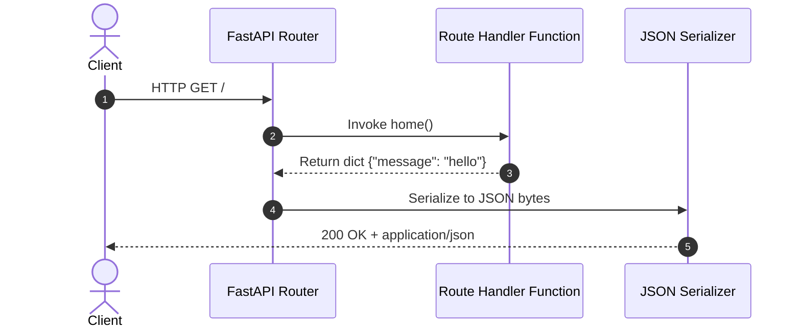

<div align="center">

# 🚀 Module 01: Basics — Your First App

[](#)
[](#)

[⏮️ Previous: 00 Setup](../00_setup/README.md) • [📚 Course Overview](../README.md) • [Next: 02 Routing & Params ⏭️](../02_routing_params/README.md)

---

</div>

## 📌 Architectural Overview

Every FastAPI application centers around the primary `FastAPI()` application instance. Routes are attached via method decorators (`@app.get()`, `@app.post()`, etc.) that act as endpoint controllers.



---

## 💡 Core Theoretical Concepts

### 1. Application Instance & Route Decorators

A route handler is a standard Python function (or coroutine) bound to an HTTP method and URL path:

```python
from fastapi import FastAPI

app = FastAPI(title="Task Manager API", version="1.0.0")

@app.get("/")
def home():
    return {"message": "hello world"}
```

- **Decorator syntax**: `@app.<method>(path)` registers the route into the ASGI route table.
- **Automatic JSON Serialization**: FastAPI automatically encodes Python primitive types (dictionaries, lists, strings, integers, dataclasses) into valid JSON responses with appropriate `Content-Type: application/json` headers.

### 2. RESTful HTTP Verb Conventions

| HTTP Verb | Operation | Idempotent | Side Effects | Example Endpoint |
| :--- | :--- | :---: | :---: | :--- |
| `GET` | Read resource | Yes | None | `GET /tasks` |
| `POST` | Create new resource | No | Mutates state | `POST /tasks` |
| `PUT` | Replace entire resource | Yes | Overwrites | `PUT /tasks/{id}` |
| `PATCH` | Partial update | No | Mutates specific fields | `PATCH /tasks/{id}` |
| `DELETE` | Delete resource | Yes | Removes resource | `DELETE /tasks/{id}` |

---

## 🎯 Task Specifications: The Task Manager API

In this foundational module, you will initialize the core routing skeleton for the **Task Manager API** using an in-memory Python list.

### Route Contract

| Method | Path | Summary | Request Body | Status Code | Response Body |
| :--- | :--- | :--- | :--- | :---: | :--- |
| `GET` | `/` | API Health / Welcome | None | `200 OK` | `{"message": "Task Manager API is running"}` |
| `GET` | `/tasks` | List all tasks | None | `200 OK` | `[{"id": 1, "title": "Buy groceries", ...}]` |
| `POST` | `/tasks` | Create task placeholder | None | `200 OK` | `{"received": "ok"}` |
| `GET` | `/ping` | Keepalive ping check | None | `200 OK` | `{"pong": True}` |

---

## 🛠️ Step-by-Step Implementation

1. Open `question/starter.py`.
2. Inspect the predefined `tasks` list containing initial dummy items.
3. Complete the `# TODO` items:
   - Wire the root index endpoint `GET /`.
   - Wire the retrieval endpoint `GET /tasks` returning the full list.
   - Wire the creation placeholder `POST /tasks`.
   - Wire the heartbeat check `GET /ping`.
4. Run the development server:
   ```bash
   fastapi dev question/starter.py
   ```
5. Test all four endpoints directly inside Swagger UI at `http://127.0.0.1:8000/docs`.

---

## 🧪 Verification Commands

```bash
# Test Root
curl -X GET http://127.0.0.1:8000/

# Test Task Listing
curl -X GET http://127.0.0.1:8000/tasks

# Test Ping Check
curl -X GET http://127.0.0.1:8000/ping
```

---

<div align="center">

[⏮️ Previous: 00 Setup](../00_setup/README.md) • [📚 Course Overview](../README.md) • [Next: 02 Routing & Params ⏭️](../02_routing_params/README.md)

</div>
