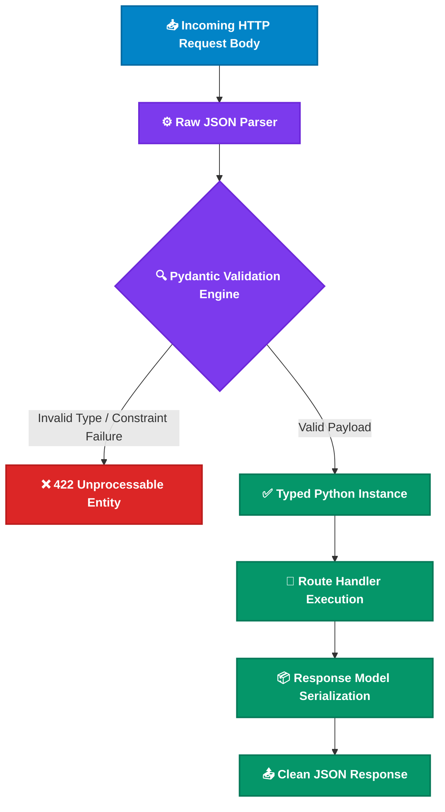

<div align="center">

# 🛡️ Module 03: Pydantic Validation & Data Modeling

[](#)
[](#)

[⏮️ Previous: 02 Routing & Params](../02_routing_params/README.md) • [📚 Course Overview](../README.md) • [Next: 04 Error Handling ⏭️](../04_error_handling/README.md)

---

</div>

## 📌 Architectural Overview

Pydantic v2 powers FastAPI's data validation, parsing, serialization, and OpenAPI schema generation. When a request hits an endpoint with a Pydantic model parameter, FastAPI executes an automated parsing pipeline:



---

## 💡 Core Theoretical Concepts

### 1. Request Body Validation with `BaseModel`

Unlike query or path parameters, complex JSON payloads are defined by inheriting from Pydantic's `BaseModel`:

```python
from pydantic import BaseModel, Field, field_validator

class TaskCreate(BaseModel):
    title: str = Field(min_length=1, max_length=100, description="Task title")
    priority: int = Field(default=3, ge=1, le=5, description="Priority from 1 (low) to 5 (urgent)")
    done: bool = False

    @field_validator("title")
    @classmethod
    def validate_title(cls, value: str) -> str:
        cleaned = value.strip()
        if not cleaned:
            raise ValueError("Title cannot be whitespace only.")
        return cleaned
```

### 2. Schema Segregation: Input (`TaskCreate`) vs Output (`TaskRead`)

Never reuse the exact same model for database persistence, inputs, and outputs. Separation of concerns prevents severe security vulnerabilities like **Mass Assignment**:
- **`TaskCreate`**: Contains client-submittable fields. It never includes server-generated metadata like `id` or `created_at`.
- **`TaskRead`**: Contains all fields exposed back to clients, including auto-generated IDs.

```python
class TaskRead(TaskCreate):
    id: int
```

### 3. Response Filtering via `response_model`

The `response_model` argument in route decorators ensures outgoing responses match the expected schema and strips unwanted or private attributes:

```python
@app.post("/tasks", response_model=TaskRead, status_code=201)
def create_task(task: TaskCreate):
    ...
```

---

## 🎯 Task Specifications

Upgrade the Task Manager API to accept structured payloads, enforce validation rules, and return strictly typed responses.

### Schema Definitions

```
TaskCreate:
├── title: str (1..100 characters, non-blank stripped)
├── priority: int (1..5, default: 3)
└── done: bool (default: False)

TaskRead (inherits TaskCreate):
└── id: int
```

### Route Contract

| Method | Path | Request Body | Response Model | Status Code | Notes |
| :--- | :--- | :--- | :--- | :---: | :--- |
| `POST` | `/tasks` | `TaskCreate` | `TaskRead` | `201 Created` | Validates payload, assigns incremented ID, stores in list |
| `GET` | `/tasks` | None | `list[TaskRead]` | `200 OK` | Serializes all tasks through `TaskRead` |

---

## 🛠️ Step-by-Step Implementation

1. Open `question/starter.py`.
2. Define `TaskCreate` with Pydantic `Field` constraints.
3. Attach `@field_validator("title")` to reject whitespace-only strings.
4. Define `TaskRead` inheriting from `TaskCreate` with `id: int`.
5. Update `POST /tasks` to accept `TaskCreate`, assign an ID, and return the created task.
6. Verify validation via Swagger UI.

---

## 🧪 Verification Commands

```bash
# Valid Task Creation (HTTP 201 Created)
curl -X POST http://127.0.0.1:8000/tasks \
  -H "Content-Type: application/json" \
  -d '{"title": "Implement authentication", "priority": 5}'

# Invalid Task Creation - Empty Title (Triggers HTTP 422)
curl -X POST http://127.0.0.1:8000/tasks \
  -H "Content-Type: application/json" \
  -d '{"title": "   ", "priority": 1}'

# Invalid Priority Out of Bounds (Triggers HTTP 422)
curl -X POST http://127.0.0.1:8000/tasks \
  -H "Content-Type: application/json" \
  -d '{"title": "Valid title", "priority": 10}'
```

---

<div align="center">

[⏮️ Previous: 02 Routing & Params](../02_routing_params/README.md) • [📚 Course Overview](../README.md) • [Next: 04 Error Handling ⏭️](../04_error_handling/README.md)

</div>
