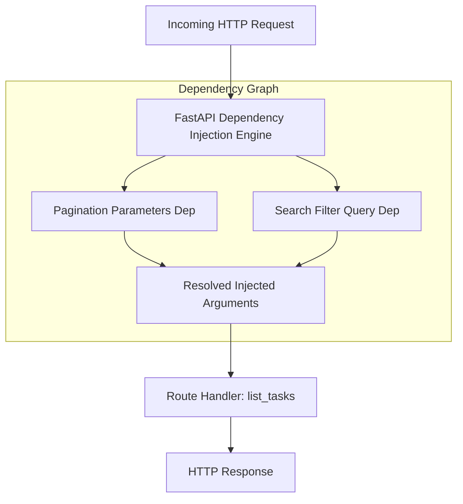

<div align="center">

# 💉 Module 05: Dependency Injection & Composable Architecture

[](#)
[](#)

[⏮️ Previous: 04 Error Handling](../04_error_handling/README.md) • [📚 Course Overview](../README.md) • [Next: 06 Database SQLModel ⏭️](../06_database_sqlmodel/README.md)

---

</div>

## 📌 Architectural Overview

FastAPI features one of the most powerful and intuitive **Dependency Injection (DI)** engines in modern programming. Instead of manually parsing headers, verifying security, or managing database connections in every route, dependencies allow you to declare shared sub-tasks as reusable callable functions.



---

## 💡 Core Theoretical Concepts

### 1. The Anatomy of a Dependency

A dependency is any callable (function, class, generator). `Depends()` instructs FastAPI to execute the callable before invoking the endpoint and pass its return value into the handler:

```python
from typing import Annotated
from fastapi import Depends, Query

def pagination_params(
    skip: Annotated[int, Query(ge=0)] = 0,
    limit: Annotated[int, Query(ge=1, le=100)] = 10,
):
    return {"skip": skip, "limit": limit}

PaginationDep = Annotated[dict, Depends(pagination_params)]

@app.get("/tasks")
def list_tasks(pagination: PaginationDep):
    return {"skip": pagination["skip"], "limit": pagination["limit"]}
```

### 2. Why Use Dependency Injection?

1. **DRY Logic**: Define parameter extraction, validation, and database queries once; reuse them across hundreds of endpoints.
2. **Hierarchical Trees**: Dependencies can themselves depend on other dependencies (e.g. `get_current_user` depends on `get_db_session` and `oauth2_scheme`).
3. **Effortless Mocking in Tests**: In automated tests, you can override any dependency (e.g. `app.dependency_overrides[get_session] = get_test_db`) without modifying production route code.
4. **Lifecycle Resource Management (`yield`)**: Dependencies using `yield` execute setup code before the route runs and guarantee teardown/cleanup code runs after the response is dispatched (vital for database sessions).

```python
def get_resource():
    resource = acquire_connection()
    try:
        yield resource
    finally:
        resource.close()
```

---

## 🎯 Task Specifications

Refactor and supercharge `question/starter.py` by decoupling query logic into standalone dependencies.

### Dependency Definitions

1. **`pagination_params`**:
   - `skip: int = 0` (minimum 0).
   - `limit: int = Query(default=10, ge=1, le=100)`.
   - Returns dictionary: `{"skip": skip, "limit": limit}`.
   - Declare type alias `PaginationDep = Annotated[dict, Depends(pagination_params)]`.

2. **`verify_title_query`**:
   - Accepts optional query `search: str | None = None`.
   - Returns sanitized lowercase string, or `None` if omitted.
   - Declare type alias `SearchDep = Annotated[str | None, Depends(verify_title_query)]`.

### Route Contract

| Method | Path | Injected Dependencies | Behavior |
| :--- | :--- | :--- | :--- |
| `GET` | `/tasks` | `pagination: PaginationDep`<br>`search: SearchDep` | Filters tasks containing search keyword (case-insensitive), applies `skip` and `limit` slicing |

---

## 🛠️ Step-by-Step Implementation

1. Open `question/starter.py`.
2. Construct `pagination_params` returning `{"skip": skip, "limit": limit}`.
3. Construct `verify_title_query` sanitizing search inputs.
4. Create reusable `Annotated` type aliases for both.
5. In `GET /tasks`, inject both dependencies and apply the filtering and slicing logic.
6. Verify multiple query combinations in `/docs`.

---

## 🧪 Verification Commands

```bash
# Test combined pagination and search
curl -X GET "http://127.0.0.1:8000/tasks?search=fastapi&skip=0&limit=5"

# Test limit validation out of range (HTTP 422)
curl -X GET "http://127.0.0.1:8000/tasks?limit=200"
```

---

<div align="center">

[⏮️ Previous: 04 Error Handling](../04_error_handling/README.md) • [📚 Course Overview](../README.md) • [Next: 06 Database SQLModel ⏭️](../06_database_sqlmodel/README.md)

</div>
