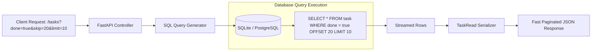

<div align="center">

# 📑 Module 07: Full CRUD, Pagination & SQL-Level Filtering

[](#)
[](#)

[⏮️ Previous: 06 Database SQLModel](../06_database_sqlmodel/README.md) • [📚 Course Overview](../README.md) • [Next: 08 Authentication OAuth2 JWT ⏭️](../08_auth_oauth2_jwt/README.md)

---

</div>

## 📌 Architectural Overview

In production backend engineering, pagination and filtering must execute directly on the database engine. Loading an entire database table into application RAM and slicing a Python list causes severe memory exhaustion and slow response times at scale.

This module unifies clean **schema inheritance modeling** with high-performance **SQL-level filtering, pagination (`OFFSET` / `LIMIT`), and complete CRUD semantics**.



---

## 💡 Core Theoretical Concepts

### 1. Hierarchical SQLModel Inheritance Pattern

To keep code DRY while preventing security flaws, split your data structures into clear inheritance tiers:

```python
from sqlmodel import SQLModel, Field

# 1. Base schema (shared fields)
class TaskBase(SQLModel):
    title: str
    priority: int = 3
    done: bool = False

# 2. Database Table Model
class Task(TaskBase, table=True):
    id: int | None = Field(default=None, primary_key=True)

# 3. Create Schema (input payload)
class TaskCreate(TaskBase):
    pass

# 4. Read Schema (output payload with guaranteed ID)
class TaskRead(TaskBase):
    id: int

# 5. Partial Update Schema (all fields optional)
class TaskUpdate(SQLModel):
    title: str | None = None
    priority: int | None = None
    done: bool | None = None
```

### 2. SQL Filtering and Pagination

Construct SQLAlchemy queries conditionally before dispatching:

```python
statement = select(Task)

if done is not None:
    statement = statement.where(Task.done == done)

statement = statement.offset(skip).limit(limit)
results = session.exec(statement).all()
```

### 3. Updating and Deleting Entities

```python
# Partial Update
db_task = session.get(Task, task_id)
update_data = task_update.model_dump(exclude_unset=True)
db_task.sqlmodel_update(update_data)
session.add(db_task)
session.commit()
session.refresh(db_task)

# Delete
session.delete(db_task)
session.commit()
```

---

## 🎯 Task Specifications

Implement a complete, production-grade CRUD suite in `question/starter.py`.

### Route Contract

| Method | Path | Request Body | Response Model | Status Code | Description |
| :--- | :--- | :--- | :--- | :---: | :--- |
| `POST` | `/tasks` | `TaskCreate` | `TaskRead` | `201 Created` | Create new task row |
| `GET` | `/tasks` | Query: `done`, `skip`, `limit` | `list[TaskRead]` | `200 OK` | Paginated and filtered task query |
| `GET` | `/tasks/{task_id}` | None | `TaskRead` | `200 OK` | Fetch task by primary key (404 if missing) |
| `PATCH` | `/tasks/{task_id}` | `TaskUpdate` | `TaskRead` | `200 OK` | Update only provided attributes |
| `DELETE` | `/tasks/{task_id}` | None | `dict` / `None` | `204 No Content` | Delete record from database |

---

## 🛠️ Step-by-Step Implementation

1. Open `question/starter.py`.
2. Implement schema hierarchy (`TaskBase`, `Task`, `TaskCreate`, `TaskRead`, `TaskUpdate`).
3. Complete `POST /tasks` with status code `201`.
4. Complete `GET /tasks` with SQL-level `where`, `offset`, and `limit`.
5. Implement `GET /tasks/{task_id}` with 404 validation.
6. Implement `PATCH /tasks/{task_id}` using `.model_dump(exclude_unset=True)`.
7. Implement `DELETE /tasks/{task_id}` using `session.delete()`.
8. Verify all 5 endpoints via Swagger UI.

---

## 🧪 Verification Commands

```bash
# 1. Create Task
curl -X POST http://127.0.0.1:8000/tasks \
  -H "Content-Type: application/json" \
  -d '{"title": "Complete full CRUD module", "priority": 5}'

# 2. Paginated Query
curl -X GET "http://127.0.0.1:8000/tasks?skip=0&limit=10"

# 3. Partial Update (PATCH)
curl -X PATCH http://127.0.0.1:8000/tasks/1 \
  -H "Content-Type: application/json" \
  -d '{"done": true}'

# 4. Delete
curl -X DELETE http://127.0.0.1:8000/tasks/1
```

---

<div align="center">

[⏮️ Previous: 06 Database SQLModel](../06_database_sqlmodel/README.md) • [📚 Course Overview](../README.md) • [Next: 08 Authentication OAuth2 JWT ⏭️](../08_auth_oauth2_jwt/README.md)

</div>
