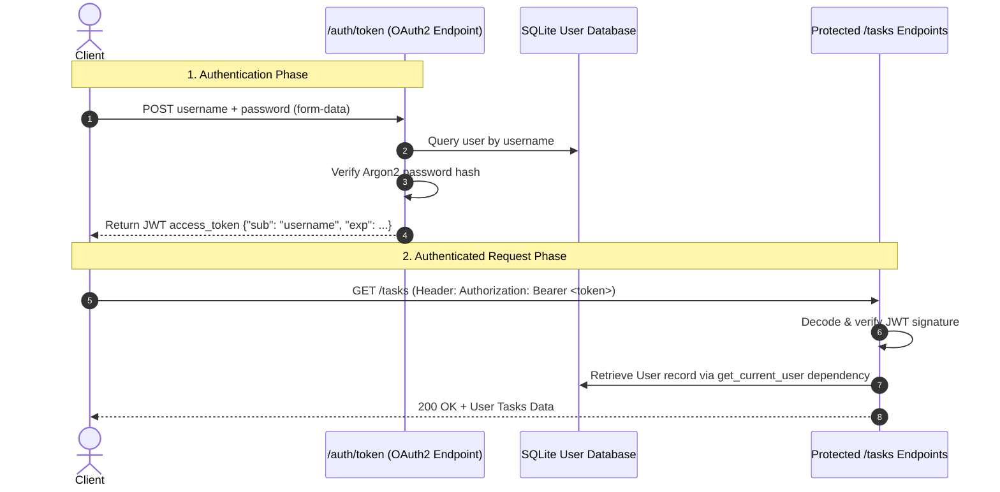

<div align="center">

# 🔐 Module 08: Authentication with OAuth2 & JWT

[](#)
[](#)

[⏮️ Previous: 07 Full CRUD & Pagination](../07_crud_pagination/README.md) • [📚 Course Overview](../README.md) • [Next: 09 Role-Based Authorization ⏭️](../09_authorization_roles/README.md)

---

</div>

## 📌 Architectural Overview

Authentication answers the foundational security question: **"Who are you?"**

This module implements the industry-standard **OAuth2 Password Flow with Bearer JSON Web Tokens (JWT)**. Passwords are securely hashed with modern **Argon2** via `pwdlib`, and endpoints are protected using composable FastAPI dependencies.



---

## 💡 Core Theoretical Concepts

### 1. Modern Password Hashing with `pwdlib` & Argon2

Never store plain text or MD5/SHA256 passwords. Use modern memory-hard key derivation algorithms like **Argon2**:

```python
from pwdlib import PasswordHash

pwd_context = PasswordHash.recommended()

# Hash password
hashed: str = pwd_context.hash("plain-password")

# Verify password
is_valid: bool = pwd_context.verify("plain-password", hashed)
```

### 2. Stateless Bearer Tokens with PyJWT

JWTs are cryptographically signed tokens containing a JSON payload (claims). Because they are verified via signature, the server does not need to query a Redis session store on every request:

```python
import jwt
from datetime import datetime, timezone, timedelta

SECRET_KEY = "dev-secret-key-change-in-production"
ALGORITHM = "HS256"

def create_access_token(data: dict, expires_delta: timedelta | None = None) -> str:
    to_encode = data.copy()
    expire = datetime.now(timezone.utc) + (expires_delta or timedelta(minutes=30))
    to_encode.update({"exp": expire})
    return jwt.encode(to_encode, SECRET_KEY, algorithm=ALGORITHM)
```

### 3. Protecting Endpoints via `get_current_user` Dependency

```python
from fastapi.security import OAuth2PasswordBearer
from fastapi import Depends, HTTPException, status
from typing import Annotated

oauth2_scheme = OAuth2PasswordBearer(tokenUrl="/auth/token")

def get_current_user(token: Annotated[str, Depends(oauth2_scheme)], session: SessionDep) -> User:
    try:
        payload = jwt.decode(token, SECRET_KEY, algorithms=[ALGORITHM])
        username: str = payload.get("sub")
        if not username:
            raise HTTPException(status.HTTP_401_UNAUTHORIZED, "Invalid credentials")
    except jwt.PyJWTError:
        raise HTTPException(status.HTTP_401_UNAUTHORIZED, "Invalid or expired token")

    user = session.exec(select(User).where(User.username == username)).first()
    if not user:
        raise HTTPException(status.HTTP_401_UNAUTHORIZED, "User not found")
    return user

CurrentUserDep = Annotated[User, Depends(get_current_user)]
```

---

## 🎯 Task Specifications

Update `question/starter.py` to add user registration, login, and token-protected task creation.

### Route Contract

| Method | Path             | Request Body                       |  Status Code  | Description                                                                 |
| :----- | :--------------- | :--------------------------------- | :-----------: | :-------------------------------------------------------------------------- |
| `POST` | `/auth/register` | `UserCreate` (JSON)                | `201 Created` | Hash password, create User row                                              |
| `POST` | `/auth/token`    | `OAuth2PasswordRequestForm` (Form) |   `200 OK`    | Authenticate user, return `{"access_token": token, "token_type": "bearer"}` |
| `GET`  | `/users/me`      | None (Bearer Token)                |   `200 OK`    | Return current authenticated user profile                                   |
| `POST` | `/tasks`         | `TaskCreate` (Bearer Token)        | `201 Created` | Create task owned by current user                                           |

---

## 🛠️ Step-by-Step Implementation

1. Open `question/starter.py`.
2. Define `User` SQLModel table (`id`, `username`, `hashed_password`).
3. Set up `PasswordHash.recommended()` for Argon2 hashing.
4. Implement `create_access_token` with expiration time.
5. Build `POST /auth/register` and `POST /auth/token`.
6. Implement `get_current_user` and create `CurrentUserDep`.
7. Protect `GET /users/me` and `POST /tasks` using `CurrentUserDep`.
8. Click the **Authorize 🔓** button in `/docs` to test seamlessly.

---

## 🧪 Verification Commands

```bash
# 1. Register a new user
curl -X POST http://127.0.0.1:8000/auth/register \
  -H "Content-Type: application/json" \
  -d '{"username": "himanshu", "password": "SuperSecretPassword123"}'

# 2. Acquire JWT Bearer Token
curl -X POST http://127.0.0.1:8000/auth/token \
  -F "username=himanshu" \
  -F "password=SuperSecretPassword123"

# 3. Access Protected /users/me Endpoint
curl -X GET http://127.0.0.1:8000/users/me \
  -H "Authorization: Bearer <PASTE_YOUR_ACCESS_TOKEN>"
```

---

<div align="center">

[⏮️ Previous: 07 Full CRUD & Pagination](../07_crud_pagination/README.md) • [📚 Course Overview](../README.md) • [Next: 09 Role-Based Authorization ⏭️](../09_authorization_roles/README.md)

</div>
