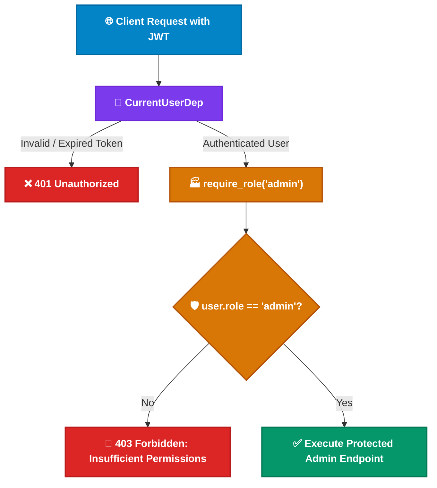

<div align="center">

# 👥 Module 09: Role-Based Authorization (RBAC)

[](#)
[](#)

[⏮️ Previous: 08 Authentication OAuth2 JWT](../08_auth_oauth2_jwt/README.md) • [📚 Course Overview](../README.md) • [Next: 10 Middleware & CORS ⏭️](../10_middleware_cors/README.md)

---

</div>

## 📌 Architectural Overview

While **Authentication** verifies *identity* ("who are you?"), **Authorization** governs *permission* ("are you allowed to perform this operation?").

In this module, you build a production-grade **Role-Based Access Control (RBAC)** architecture using FastAPI's **Dependency Factory** pattern: a higher-order function that generates tailored dependencies parameterized by the required role.



---

## 💡 Core Theoretical Concepts

### 1. HTTP 401 vs HTTP 403

| Status | Name | Meaning | Trigger |
| :---: | :--- | :--- | :--- |
| **`401`** | **Unauthorized** | Missing, malformed, or expired token | Client failed to prove identity |
| **`403`** | **Forbidden** | User authenticated, but lacks permission | User identity verified, but role is restricted |

### 2. Dependency Factories in FastAPI

A dependency factory is a standard Python function that returns a closure. FastAPI resolves the inner closure as a first-class dependency:

```python
from fastapi import Depends, HTTPException, status

def require_role(required_role: str):
    def role_checker(current_user: CurrentUserDep) -> User:
        if current_user.role != required_role:
            raise HTTPException(
                status_code=status.HTTP_403_FORBIDDEN,
                detail=f"Operation requires '{required_role}' privileges.",
            )
        return current_user
    return role_checker

AdminDep = Annotated[User, Depends(require_role("admin"))]
```

### 3. Securing Endpoints with Role Dependencies

```python
@app.delete("/tasks/{task_id}")
def delete_task(task_id: int, current_admin: AdminDep, session: SessionDep):
    # Only authenticated users with role='admin' can execute this
    ...
```

---

## 🎯 Task Specifications

Update `question/starter.py` to enforce role constraints.

### Schema & Role Updates

- Extend `User` table to include a `role: str = Field(default="user")` column.
- Allow role specification during registration (`UserCreate` includes `role: str = "user"`).

### Route Contract

| Method | Path | Required Role | Status Code | Description |
| :--- | :--- | :---: | :---: | :--- |
| `POST` | `/auth/register` | Public | `201 Created` | Register new user with default or specified role |
| `POST` | `/auth/token` | Public | `200 OK` | OAuth2 password token exchange |
| `GET` | `/users` | `admin` | `200 OK` | List all system users (403 for non-admins) |
| `DELETE` | `/tasks/{task_id}` | `admin` | `204 No Content` | Delete any task (403 for regular users) |
| `GET` | `/tasks` | `user` or `admin` | `200 OK` | View available tasks |

---

## 🛠️ Step-by-Step Implementation

1. Open `question/starter.py`.
2. Add `role: str` to `User` and `UserCreate`.
3. Construct the `require_role(required_role: str)` factory function.
4. Define `AdminDep` using `Depends(require_role("admin"))`.
5. Secure `GET /users` and `DELETE /tasks/{task_id}` with `AdminDep`.
6. Test using two accounts: a standard user (`role="user"`) and an administrator (`role="admin"`). Verify that standard users receive `403 Forbidden`.

---

## 🧪 Verification Commands

```bash
# 1. Register Regular User & Admin
curl -X POST http://127.0.0.1:8000/auth/register \
  -H "Content-Type: application/json" \
  -d '{"username": "alice", "password": "UserPass123", "role": "user"}'

curl -X POST http://127.0.0.1:8000/auth/register \
  -H "Content-Type: application/json" \
  -d '{"username": "boss", "password": "AdminPass123", "role": "admin"}'

# 2. Login as Alice & attempt admin route -> Expect HTTP 403 Forbidden
curl -X GET http://127.0.0.1:8000/users \
  -H "Authorization: Bearer <ALICE_ACCESS_TOKEN>"

# 3. Login as Boss & attempt admin route -> Expect HTTP 200 OK
curl -X GET http://127.0.0.1:8000/users \
  -H "Authorization: Bearer <BOSS_ACCESS_TOKEN>"
```

---

<div align="center">

[⏮️ Previous: 08 Authentication OAuth2 JWT](../08_auth_oauth2_jwt/README.md) • [📚 Course Overview](../README.md) • [Next: 10 Middleware & CORS ⏭️](../10_middleware_cors/README.md)

</div>
