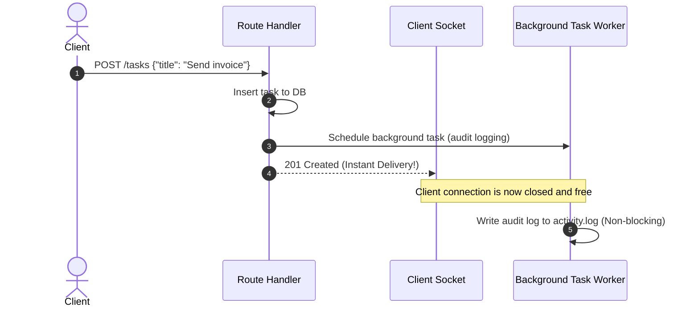

<div align="center">

# ⏱️ Module 11: Non-Blocking Background Tasks

[](#)
[](#)

[⏮️ Previous: 10 Middleware & CORS](../10_middleware_cors/README.md) • [📚 Course Overview](../README.md) • [Next: 12 File Upload & Download ⏭️](../12_file_upload_download/README.md)

---

</div>

## 📌 Architectural Overview

Often an API endpoint needs to perform actions *after* returning a response to the client — such as appending to an audit log file, dispatching email confirmations, or pinging external webhooks. Forcing the client to wait for these operations introduces unnecessary network latency.

FastAPI’s `BackgroundTasks` executes operations **asynchronously after the HTTP response has been delivered**, keeping response times instant.



---

## 💡 Core Theoretical Concepts

### 1. Declaring `BackgroundTasks`

Inject `BackgroundTasks` directly into your endpoint handler parameter list and call `.add_task()`:

```python
from fastapi import BackgroundTasks

def write_audit_log(username: str, action: str):
    with open("activity.log", "a") as f:
        f.write(f"{datetime.utcnow()} | {username} | {action}\n")

@app.post("/tasks")
def create_task(task: TaskCreate, bg: BackgroundTasks):
    # Core DB logic
    ...
    # Schedule post-response execution
    bg.add_task(write_audit_log, username="admin", action=f"Created task {task.title}")
    return {"message": "Task queued"}
```

### 2. When to Use `BackgroundTasks` vs External Queues (Celery/ARQ)

> [!IMPORTANT]
> `BackgroundTasks` runs inside the **same Python process** and shares the application's event loop and thread pool.
> - **Ideal for**: Quick file logging, fire-and-forget notifications, in-process metrics tracking.
> - **Not suited for**: Heavy CPU workloads, long-running batch jobs, operations requiring persistence across server restarts or automatic retry policies. For heavy jobs, use an external distributed task broker like **Celery**, **ARQ**, or **Dramatiq** backed by Redis or RabbitMQ.

---

## 🎯 Task Specifications

Update `question/starter.py` to schedule background audit logging for task lifecycle events.

### Route Contract

| Method | Path | Parameter | Behavior |
| :--- | :--- | :--- | :--- |
| `POST` | `/tasks` | `bg: BackgroundTasks` | Creates task, schedules background call writing `"Created task: <title>"` to `activity.log` |
| `DELETE` | `/tasks/{task_id}` | `bg: BackgroundTasks` | Deletes task, schedules background call writing `"Deleted task: <id>"` to `activity.log` |
| `POST` | `/tasks/{task_id}/notify` | `bg: BackgroundTasks` | Simulates slow notification (`time.sleep(2)`), returns **immediately** to caller, logs after delay |

---

## 🛠️ Step-by-Step Implementation

1. Open `question/starter.py`.
2. Implement `write_activity_log(username: str, message: str)` writing timestamped strings to `activity.log`.
3. Update `POST /tasks` to register `write_activity_log` via `background_tasks.add_task()`.
4. Update `DELETE /tasks/{task_id}` to schedule deletion logging.
5. Implement `POST /tasks/{task_id}/notify` simulating a 2-second delay. Notice that the HTTP response arrives in <10ms, while `activity.log` receives the record 2 seconds later.

---

## 🧪 Verification Commands

```bash
# 1. Trigger simulated slow notification
time curl -X POST http://127.0.0.1:8000/tasks/1/notify

# Verify command returns in milliseconds!

# 2. Inspect generated activity.log entries
cat activity.log
```

---

<div align="center">

[⏮️ Previous: 10 Middleware & CORS](../10_middleware_cors/README.md) • [📚 Course Overview](../README.md) • [Next: 12 File Upload & Download ⏭️](../12_file_upload_download/README.md)

</div>
