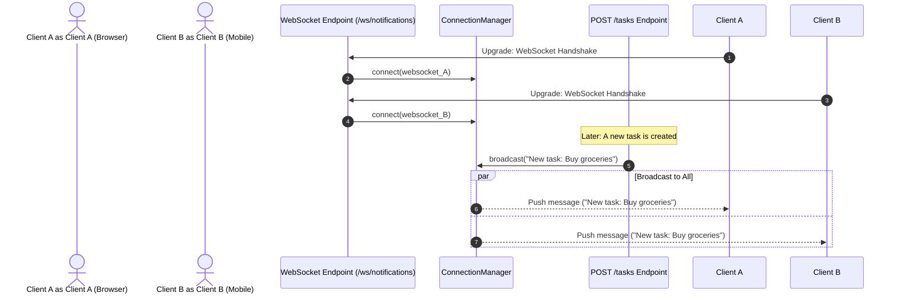

<div align="center">

# ⚡ Module 13: Full-Duplex Real-Time WebSockets

[](#)
[](#)

[⏮️ Previous: 12 File Upload & Download](../12_file_upload_download/README.md) • [📚 Course Overview](../README.md) • [Next: 14 Lifespan Events ⏭️](../14_lifespan_events/README.md)

---

</div>

## 📌 Architectural Overview

Traditional HTTP is unidirectional: the client requests data, the server answers, and the TCP connection terminates. For live collaboration, real-time dashboards, or chat applications, polling HTTP introduces severe network overhead.

**WebSockets (RFC 6455)** initiate as an HTTP handshake and upgrade into a persistent, bidirectional, full-duplex TCP channel allowing both client and server to push messages instantaneously with negligible packet overhead.



---

## 💡 Core Theoretical Concepts

### 1. WebSocket Endpoint Lifecycle

Every WebSocket endpoint manages its connection through three discrete phases:

```python
from fastapi import WebSocket, WebSocketDisconnect

@app.websocket("/ws")
async def websocket_endpoint(websocket: WebSocket):
    # 1. Accept Handshake
    await websocket.accept()
    try:
        while True:
            # 2. Receive Message (awaiting socket read)
            message = await websocket.receive_text()
            # 3. Echo / Respond
            await websocket.send_text(f"Echo: {message}")
    except WebSocketDisconnect:
        # Graceful disconnect handling
        print("Client disconnected cleanly")
```

### 2. Multi-Client Broadcasting via `ConnectionManager`

To broadcast real-time events to all active users, build a central `ConnectionManager`:

```python
class ConnectionManager:
    def __init__(self):
        self.active_connections: list[WebSocket] = []

    async def connect(self, websocket: WebSocket):
        await websocket.accept()
        self.active_connections.append(websocket)

    def disconnect(self, websocket: WebSocket):
        if websocket in self.active_connections:
            self.active_connections.remove(websocket)

    async def broadcast(self, message: str):
        for connection in list(self.active_connections):
            try:
                await connection.send_text(message)
            except Exception:
                self.disconnect(connection)

manager = ConnectionManager()
```

---

## 🎯 Task Specifications

Update `question/starter.py` to broadcast instant notifications to all active browser sessions whenever a new task is created.

### Route Contract

| Type | Path | Purpose | Behavior |
| :--- | :--- | :--- | :--- |
| **WS** | `/ws/notifications` | Real-time notification feed | Subscribes client socket to active broadcasts |
| **HTTP** | `POST /tasks` | Create task | Inserts task and calls `await manager.broadcast(f"Task created: {task.title}")` |

---

## 🛠️ Step-by-Step Implementation

1. Open `question/starter.py`.
2. Construct the `ConnectionManager` class tracking active socket connections.
3. Wire the `/ws/notifications` WebSocket endpoint.
4. Modify `POST /tasks` to invoke `await manager.broadcast(...)`.
5. Open `solution/test_client.html` in two separate browser tabs and watch messages appear instantly without refreshing!

---

## 🧪 Verification Commands

You can connect and test using the included `test_client.html` or the command-line utility `websocat`:

```bash
# Connect to websocket stream
websocat ws://127.0.0.1:8000/ws/notifications

# In another terminal, create a task via HTTP
curl -X POST http://127.0.0.1:8000/tasks \
  -H "Content-Type: application/json" \
  -d '{"title": "Real-time task alert"}'

# -> Notice the broadcast message arrives instantly in your websocat terminal!
```

---

<div align="center">

[⏮️ Previous: 12 File Upload & Download](../12_file_upload_download/README.md) • [📚 Course Overview](../README.md) • [Next: 14 Lifespan Events ⏭️](../14_lifespan_events/README.md)

</div>
