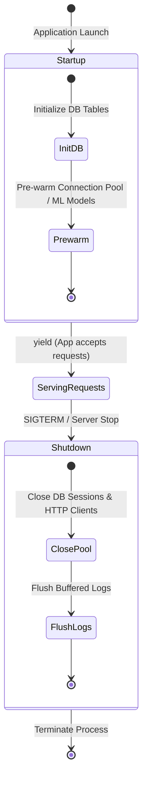

<div align="center">

# 🔄 Module 14: Modern Lifespan Event Management

[](#)
[](#)

[⏮️ Previous: 13 WebSockets](../13_websockets/README.md) • [📚 Course Overview](../README.md) • [Next: 15 Logging & Exception Handlers ⏭️](../15_logging_exception_handlers/README.md)

---

</div>

## 📌 Architectural Overview

Calling initialization logic (such as creating database schemas or instantiating connection pools) at module import time is an anti-pattern: it prevents test suites from overriding configurations, slows module imports, and cannot safely run async setup logic.

FastAPI provides the standard ASGI **Lifespan** protocol via `contextlib.asynccontextmanager`. A single context manager encapsulates both application **Startup** (pre-request preparation) and **Shutdown** (graceful resource teardown).



---

## 💡 Core Theoretical Concepts

### 1. The `@asynccontextmanager` Pattern

FastAPI replaces legacy `@app.on_event("startup")` and `@app.on_event("shutdown")` decorators with an explicit async generator:

```python
from contextlib import asynccontextmanager
from fastapi import FastAPI
from sqlmodel import SQLModel

@asynccontextmanager
async def lifespan(app: FastAPI):
    # ========================================================
    # 1. STARTUP PHASE (Runs once before accepting requests)
    # ========================================================
    print("Initializing application resources...")
    SQLModel.metadata.create_all(engine)
    
    yield  # Application is now live and serving traffic
    
    # ========================================================
    # 2. SHUTDOWN PHASE (Runs on SIGTERM / application exit)
    # ========================================================
    print("Tearing down application resources...")
    engine.dispose()

app = FastAPI(lifespan=lifespan)
```

### 2. Benefits Over Legacy Event Decorators

- **Unified Context Scope**: State initialized during startup remains in scope for shutdown teardown.
- **Exception Safety**: The `try...finally` block guarantees cleanup occurs even if startup fails halfway through.
- **ASGI Standard**: Fully conforms to Starlette and ASGI Lifespan specifications for seamless Docker and Kubernetes integration.

---

## 🎯 Task Specifications

Update `question/starter.py` to migrate schema initialization and resource cleanup to an explicit `lifespan` handler.

### Requirements

1. Construct an `async def lifespan(app: FastAPI)` function using `@asynccontextmanager`.
2. Move table creation (`SQLModel.metadata.create_all(engine)`) inside the startup phase.
3. Add a log or print statement confirming startup completion.
4. After `yield`, add a graceful cleanup log message confirming engine disposal (`engine.dispose()`).
5. Attach the handler via `FastAPI(lifespan=lifespan)`.

---

## 🛠️ Step-by-Step Implementation

1. Open `question/starter.py`.
2. Import `from contextlib import asynccontextmanager`.
3. Define the `lifespan` generator function.
4. Pass `lifespan=lifespan` when instantiating `app = FastAPI(...)`.
5. Start the application with `fastapi dev question/starter.py` and inspect terminal logs on boot and shutdown (`Ctrl+C`).

---

## 🧪 Verification Commands

```bash
# Start server in dev mode
fastapi dev question/starter.py

# Observe terminal output:
# -> Initializing application resources...
# -> Application startup complete! Serving requests.

# Press Ctrl+C to trigger SIGINT:
# -> Tearing down application resources...
# -> Engine disposed cleanly. Goodbye!
```

---

<div align="center">

[⏮️ Previous: 13 WebSockets](../13_websockets/README.md) • [📚 Course Overview](../README.md) • [Next: 15 Logging & Exception Handlers ⏭️](../15_logging_exception_handlers/README.md)

</div>
