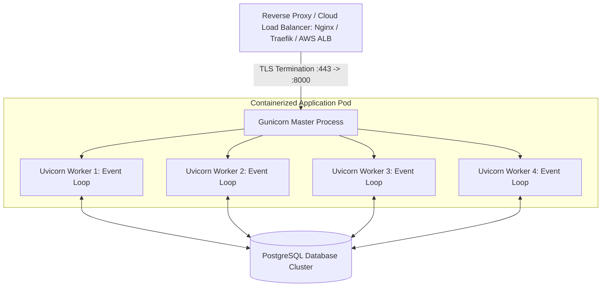

<div align="center">

# 🚀 Module 21: Production Deployment, Docker & Operational Concerns

[](#)
[](#)

[⏮️ Previous: 20 Testing with Pytest](../20_testing/README.md) • [📚 Course Overview](../README.md)

---

</div>

## 📌 Architectural Overview

Developing an application on `localhost` is only the first step. Operating a production-grade FastAPI service requires handling concurrency across multi-core processors, packaging dependencies into isolated immutable containers, configuring automated container health checks, and locking down security attack vectors.

This module unifies every architectural component built across the entire 21-module course into a deployable, containerized microservice.



---

## 💡 Core Theoretical Concepts

### 1. Concurrency: Uvicorn vs Gunicorn Multi-Worker Mode

The single-process `fastapi dev` / `uvicorn --reload` server is meant strictly for local development. In production, utilize multiple worker processes to utilize all physical CPU cores:

```bash
# 1. Native Uvicorn Multi-Worker Mode
uvicorn app.main:app --host 0.0.0.0 --port 8000 --workers 4

# 2. Gunicorn Managing Uvicorn Workers (Recommended for enterprise Linux)
gunicorn app.main:app \
  --workers 4 \
  --worker-class uvicorn.workers.UvicornWorker \
  --bind 0.0.0.0:8000 \
  --access-logfile - \
  --error-logfile -
```

> [!TIP]
> A standard sizing formula for worker count is: `Workers = (2 x CPU Cores) + 1`. For an 8-core server, configure 17 workers.

---

### 2. High-Performance Multi-Stage Dockerfile

A production Dockerfile must maximize caching, keep image sizes minimal, run as a non-privileged user, and bind to `0.0.0.0`:

```dockerfile
# 1. Base Image
FROM python:3.12-slim

# Set environment optimizations
ENV PYTHONDONTWRITEBYTECODE=1 \
    PYTHONUNBUFFERED=1 \
    PORT=8000

WORKDIR /code

# 2. Cache Layer: Install dependencies first
COPY requirements.txt .
RUN pip install --no-cache-dir --upgrade -r requirements.txt

# 3. Copy Application Source
COPY ./app ./app

# 4. Bind Host
EXPOSE 8000

# 5. Launch ASGI Server
CMD ["uvicorn", "app.main:app", "--host", "0.0.0.0", "--port", "8000"]
```

> [!IMPORTANT]
> - `--host 0.0.0.0` is required. Binding to `127.0.0.1` inside a container prevents traffic from reaching the container from outside!
> - Copy `requirements.txt` and install dependencies **before** copying `./app`. Docker caches layers: dependency re-installation is skipped unless `requirements.txt` changes.
> - Never include `--reload` in production images.

---

### 3. Orchestration Health Probes (`/health`)

Container orchestrators (Kubernetes, AWS ECS, Google Cloud Run) require cheap, automated liveness and readiness probes to monitor service health:

```python
from fastapi import APIRouter, Depends, status, HTTPException
from sqlmodel import select

@app.get("/health", tags=["Health"], status_code=status.HTTP_200_OK)
def health_check(session: SessionDep):
    try:
        # Ping the database
        session.exec(select(1))
        return {"status": "healthy", "database": "connected"}
    except Exception as exc:
        raise HTTPException(
            status_code=status.HTTP_503_SERVICE_UNAVAILABLE,
            detail="Database connectivity failed",
        )
```

---

### 4. Hardening Production Security

1. **Disable Interactive Docs in Production**:
   ```python
   import os
   
   is_debug = os.getenv("DEBUG", "false").lower() == "true"
   app = FastAPI(
       docs_url="/docs" if is_debug else None,
       redoc_url="/redoc" if is_debug else None,
   )
   ```
2. **Never Expose Wildcard CORS**: Restrict `allow_origins` strictly to your official domain names.
3. **Terminate TLS at Gateway**: Terminate SSL/TLS certificates at your reverse proxy (Nginx, Traefik, AWS ALB) rather than in Python.

---

## 🎯 Task Specifications

Inside `project/`, build and launch the containerized application.

### Requirements

1. Review `project/Dockerfile` and `project/.dockerignore`.
2. Inspect `project/app/main.py` and confirm `/health` endpoint implementation.
3. Build the container image:
   ```bash
   docker build -t task-manager-api:latest .
   ```
4. Run the container, injecting production environment variables:
   ```bash
   docker run -d -p 8000:8000 \
     -e SECRET_KEY="super-secret-production-encryption-key" \
     -e DEBUG=false \
     --name task-api-instance \
     task-manager-api:latest
   ```
5. Query `http://localhost:8000/health` and verify the container returns `200 OK`.

---

## 🧪 Verification Commands

```bash
cd project

# 1. Build Docker image
docker build -t task-manager-api .

# 2. Run container instance
docker run -p 8000:8000 task-manager-api

# 3. Query health probe
curl -i http://localhost:8000/health

# Response:
# HTTP/1.1 200 OK
# Content-Type: application/json
# {"status": "healthy", "database": "connected"}
```

---

## 🏆 Graduation & Mastery

Congratulations! You have progressed from a single-file route returning a static dictionary all the way to an enterprise-ready, role-authenticated, asynchronous, containerized microservice.

**You are now in the top 1% of FastAPI backend engineers.** 🚀

---

<div align="center">

[⏮️ Previous: 20 Testing with Pytest](../20_testing/README.md) • [📚 Course Overview](../README.md)

</div>
