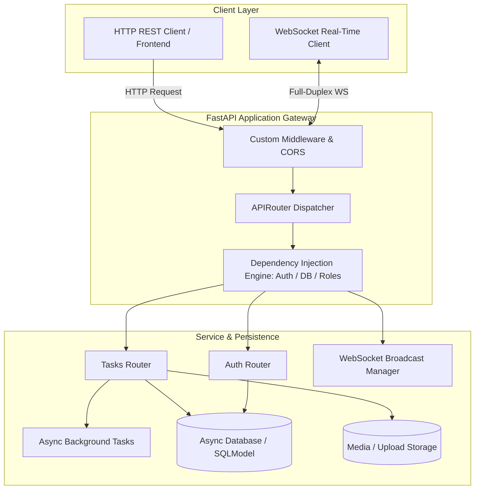

<div align="center">

# ⚡ FastAPI: Zero to Production Mastery

[](https://fastapi.tiangolo.com)
[](https://www.python.org/)
[](https://docs.pydantic.dev/)
[](https://sqlmodel.tiangolo.com/)
[](https://alembic.sqlalchemy.org/)
[](https://www.docker.com/)
[](https://opensource.org/licenses/MIT)

<p align="center">
  <strong>An industry-grade, hands-on masterclass taking you from bare-metal basics to high-concurrency, containerized production APIs.</strong>
</p>

<p align="center">
  <a href="#-curriculum-overview">Curriculum</a> •
  <a href="#-architecture-evolution">Architecture</a> •
  <a href="#-quickstart">Quickstart</a> •
  <a href="#-running-the-test-suite">Testing</a> •
  <a href="#-production-readiness-checklist">Production Checklist</a>
</p>

---

</div>

## 📖 About This Repository

This repository contains a structured, end-to-end curriculum designed to teach modern **FastAPI** the way senior backend engineers actually build it. 

Instead of disconnected, toy examples, every single module in this course incrementally evolves the **exact same project**: a production-grade **Task Management Microservice**.

```
[Module 01: In-Memory List] ──> [Module 06: SQLModel SQLite] ──> [Module 08: JWT Auth]
                                                                        │
[Module 21: Production Docker] <── [Module 18: Alembic] <── [Module 16: Router Architecture]
```

By the time you finish Module 21, your application will feature:
- 🛡️ **Zero-Trust Security**: OAuth2 password flow, cryptographic password hashing (`argon2`), signed JWT bearer tokens, and granular Role-Based Access Control (RBAC).
- ⚡ **High-Concurrency Async Engine**: Dual-stack database persistence (SQLModel + SQLAlchemy 2.0 Async + `asyncpg`/`aiosqlite`) with connection pooling.
- 🔄 **Safe Database Migrations**: Automated schema version tracking, rollbacks, and upgrade scripts using Alembic.
- 🔌 **Real-Time & Background Processing**: Full-duplex WebSockets with connection broadcast managers, plus non-blocking asynchronous background jobs.
- 🧩 **Modular Clean Architecture**: Domain-driven feature slicing with `APIRouter`, reusable `Annotated` dependency injection factories, and centralized error middleware.
- 📦 **Containerized Production Ready**: Multi-worker Uvicorn configurations, Docker builds, 12-factor `pydantic-settings` management, health checks, and comprehensive `pytest` test suites.

---

## 🏛️ Architecture Evolution



---

## 🗺️ Curriculum Overview

| Module | Title | Focus & Core Primitives | Difficulty |
| :---: | :--- | :--- | :---: |
| **[00](00_setup/README.md)** | **Setup & Tooling** | ASGI foundation, Uvicorn, virtual environments, OpenAPI docs | `Foundations` |
| **[01](01_basics/README.md)** | **Basics: Your First App** | `@app.get`, route decorators, automatic JSON serialization | `Foundations` |
| **[02](02_routing_params/README.md)** | **Routing & Parameters** | Path parameters, query parameters, `Query()` metadata & validation | `Foundations` |
| **[03](03_pydantic_validation/README.md)** | **Pydantic Validation** | `BaseModel`, schema separation (`Create`/`Read`), `@field_validator` | `Foundations` |
| **[04](04_error_handling/README.md)** | **Error Handling** | `HTTPException`, semantic HTTP status codes, structured errors | `Foundations` |
| **[05](05_dependency_injection/README.md)** | **Dependency Injection** | `Depends()`, `Annotated` aliases, composable DI, `yield` dependencies | `Intermediate` |
| **[06](06_database_sqlmodel/README.md)** | **Database with SQLModel** | Relational tables, `SessionDep`, lifecycle hooks, SQLite engine | `Intermediate` |
| **[07](07_crud_pagination/README.md)** | **Full CRUD & Pagination** | Database filtering, `offset()` & `limit()`, `exclude_unset` updates | `Intermediate` |
| **[08](08_auth_oauth2_jwt/README.md)** | **Authentication & JWT** | `OAuth2PasswordBearer`, `pwdlib[argon2]`, PyJWT token signing | `Intermediate` |
| **[09](09_authorization_roles/README.md)** | **Role-Based Authorization** | Dependency factories, RBAC enforcement, hierarchical permissions | `Intermediate` |
| **[10](10_middleware_cors/README.md)** | **Middleware & CORS** | Request wrapping, performance headers (`X-Process-Time`), CORS security | `Intermediate` |
| **[11](11_background_tasks/README.md)** | **Background Tasks** | Non-blocking post-response jobs, asynchronous task queues | `Intermediate` |
| **[12](12_file_upload_download/README.md)** | **File Upload & Download** | Streaming with `UploadFile`, directory sanitization, `FileResponse` | `Intermediate` |
| **[13](13_websockets/README.md)** | **Real-Time WebSockets** | Full-duplex connections, `ConnectionManager`, multi-client broadcasting | `Intermediate` |
| **[14](14_lifespan_events/README.md)** | **Lifespan Events** | Modern `asynccontextmanager` startup/shutdown lifecycle orchestration | `Intermediate` |
| **[15](15_logging_exception_handlers/README.md)** | **Logging & Custom Handlers** | Structured logging, domain exceptions, global error sanitization | `Intermediate` |
| **[16](16_routers_project_structure/README.md)** | **Routers & Clean Structure** | Modular `APIRouter` breakdown, clean feature architecture | `Advanced` |
| **[17](17_async_database/README.md)** | **Async Database Layer** | SQLAlchemy 2.0 `AsyncEngine`, `asyncpg`, `aiosqlite`, non-blocking I/O | `Advanced` |
| **[18](18_migrations_alembic/README.md)** | **Migrations with Alembic** | Schema version control, autogeneration, forward/backward revisions | `Advanced` |
| **[19](19_pydantic_settings/README.md)** | **12-Factor Settings** | `pydantic-settings`, `.env` isolation, typed configuration objects | `Advanced` |
| **[20](20_testing/README.md)** | **Automated Testing** | `pytest`, `TestClient`, isolated fixture databases, mock overrides | `Advanced` |
| **[21](21_deployment_production/README.md)** | **Production & Docker** | Multi-worker Uvicorn/Gunicorn, multi-stage Docker builds, health probes | `Advanced` |

---

## ⚡ Quickstart

### 1. Clone & Set Up Virtual Environment

```bash
# Clone the repository
git clone https://github.com/himanshu-jadhav108/FastAPI-Mastery.git
cd FastAPI-Mastery

# Create and activate virtual environment
python -m venv venv

# Windows (PowerShell):
.\venv\Scripts\Activate.ps1

# Linux / macOS:
source venv/bin/activate
```

### 2. Install Dependencies

```bash
pip install -r requirements.txt
```

### 3. Launching Any Module

Every module folder contains:
- `README.md` — In-depth architectural guide, theory, and challenge requirements.
- `question/starter.py` — Scaffolded starter file with `# TODO` markers.
- `solution/solution.py` — Complete, reference implementation.

```bash
# Example: Launching Module 09 (Role-Based Authorization)
cd 09_authorization_roles
fastapi dev solution/solution.py
```

Visit the interactive documentation:
- 🚀 **Interactive Swagger UI**: `http://127.0.0.1:8000/docs`
- 📚 **Alternative ReDoc UI**: `http://127.0.0.1:8000/redoc`

---

## 🧪 Running the Test Suite

We use `pytest` alongside FastAPI's `TestClient` (built on HTTPX) for ultra-fast, in-process integration testing:

```bash
# Run tests for module 20
pytest 20_testing/solution/solution_test_app.py -v
```

---

## 🛡️ Production Readiness Checklist

When preparing your FastAPI services for enterprise production:

> [!IMPORTANT]
> - [x] **Strict Secret Segregation**: Passwords, encryption keys, and tokens loaded via `pydantic-settings` from environment variables, never hardcoded.
> - [x] **Argon2 Password Hashing**: Modern, memory-hard hashing via `pwdlib[argon2]` avoiding legacy vulnerabilities.
> - [x] **Explicit CORS Whitelist**: Never combine wildcard `allow_origins=["*"]` with `allow_credentials=True`.
> - [x] **Asynchronous DB I/O**: High-throughput endpoints powered by `AsyncEngine` with connection pooling.
> - [x] **Lifecycle Health Probes**: `/health` endpoint validating database liveness for Kubernetes / Docker Swarm probes.
> - [x] **Alembic Schema Versioning**: Zero direct database schema mutations in code; all migrations tracked via versioned scripts.
> - [x] **Multi-Worker Concurrency**: Production containers running `uvicorn --workers N` or Gunicorn workers based on CPU core capacity.

---

## 🤝 Contributing & Community

Contributions, corrections, and improvements are always welcome! Feel free to open an issue or submit a pull request.

**Author:** [Himanshu Jadhav](https://github.com/himanshu-jadhav108)  
**License:** [MIT](LICENSE)
